# Screens

Every screen of the final design (A+). Each entry links the annotated screenshot, the clean screenshot and the prototype source.

- The numbered notes below are the spec. The callouts drawn into the annotated images come from `tools/annotations.json`.
- Where an image differs from a note or from [prd-redesign.md](../prds/prd-redesign.md), the note and the PRD win.
- Names, scores and ranks are sample data. Real quiz ids are UUIDs.
- Learning cards on the images show sample sentences. The app shows the template sentences of [copy.md](copy.md#learning-sentences).
- Images show follow-up features: the daily card, the "Heute" tab, the did-you-know card and the per-quiz preview. Each is absent until its PRD ships.
- Images show a header per screen. The PRD's header table wins, and the data credit line closes every route except play.

Flows:

- **First run:** 01 → 03 → 04/05 → 06 or 07 → 08
- **Returning player:** 02 → 03 → …
- **Challenged visitor:** link in the chat → 11 while the challenger plays → 10 → 03 → 12 → 08
- **Edge cases:** 14 (reload), 15 (connection lost), 16 (every country done)

## 01 · Home, first visit

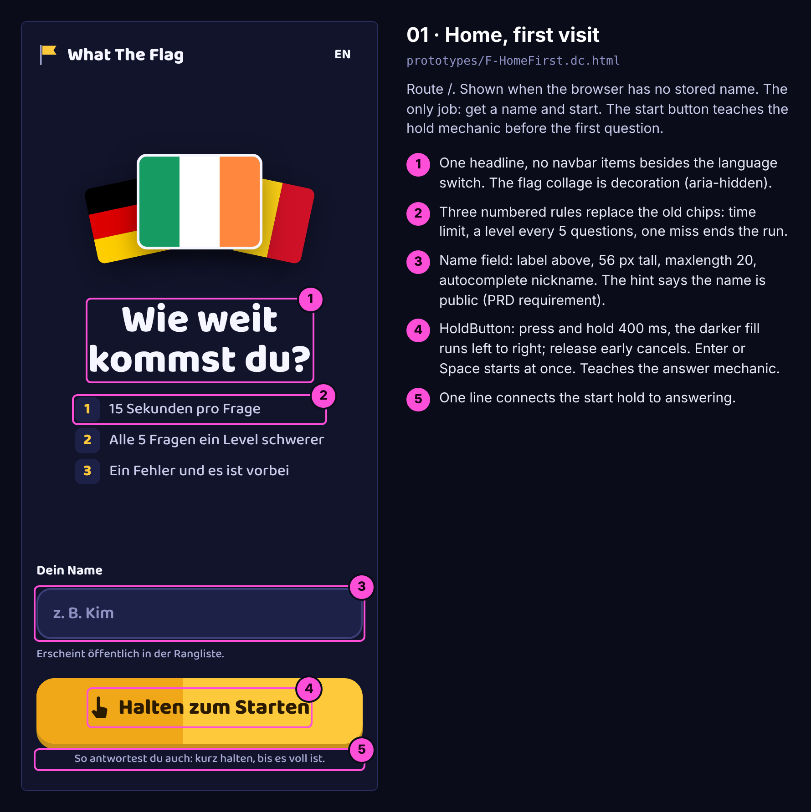

Clean: [screens/F-HomeFirst.png](screens/F-HomeFirst.png) · Prototype: [prototypes/F-HomeFirst.dc.html](prototypes/F-HomeFirst.dc.html)

Route /. Shown while `/api/me` has no `lastName`, and when `/api/me` fails. The only job: get a name and start.

1. One headline. The flag collage is decoration (`aria-hidden`).
2. Three numbered rules: time limit, a level every 5 questions up to level 10, one miss ends the run.
3. Name field: label above, 56 px tall, maxlength 20, autocomplete nickname. The hint says the name is public.
4. HoldButton. On touch, hold 400 ms while the fill runs left to right; releasing early cancels. A click, Enter or Space starts at once.
5. On touch, one line connects the start hold to answering.

## 02 · Home, returning player

Clean: [screens/F-Home.png](screens/F-Home.png) · Prototype: [prototypes/F-Home.dc.html](prototypes/F-Home.dc.html)

Route /. Shown when `/api/me` has a `lastName`. Record first, then the ways in.

1. The image shows an overtaken card. It is not part of v1.
2. Personal best: `best` from `/api/me` as the hero number. Below it "Dein bester Platz: N weltweit" from `worldRank`, when set. No level is shown.
3. The image shows the daily quiz card. It is absent until that PRD ships.
4. Primary action, a plain button (a mistaken start costs nothing). 72 px tall, in the thumb zone.
5. `lastName` is shown, not asked again. "Name ändern" swaps the line for the name field.
6. "Dein letztes Quiz" links to `/q/:lastQuizId`, when set.

## 03 · Question (playable)

Clean: [screens/F-Question.png](screens/F-Question.png) · Prototype: [prototypes/F-Question.dc.html](prototypes/F-Question.dc.html)

Route /play/:runId. The core screen. No site header. Play header: level and streak; then the timer; then the prompt; answers in the thumb zone. Playable in tools/preview.html.

1. "Level N · Rank" from the question's `level`, 1 to 10, with the rank names of copy.md. Five pips: done, current (45 %), open (outlined). At level 10 they keep counting blocks of five.
2. Streak pill with flame: the current score. "+1" pops on each correct answer.
3. Gap pill: "Rekord in N", "Rekord eingestellt", then "Neuer Rekord" in gold. N counts to beating `best`. A first run shows none. A challenge run counts to the creator.
4. Timer bar from the server deadline (existing Countdown logic). Gold, orange at 5 s, red at 3 s, plus the number.
5. Prompt: question text, then a flag (232×174) or a word (28–46 px, gold, at most two lines). A NOT question adds the NICHT pill.
6. AnswerOption: full width, at least 64 px, 12 px gap for text; 2×2 grid, at least 124 px for flags.
   On touch, hold 400 ms to answer; sliding off or releasing early cancels. A click, Enter or Space answers at once.
   Options are `aria-disabled` for the first 400 ms of each question (arming).
7. On touch, the hint line shows for the first three questions of a first run. While a press is held it reads "Festhalten …".

## 04 · Correct, record passed live

Clean: [screens/F-Correct.png](screens/F-Correct.png) · Prototype: [prototypes/F-Correct.dc.html](prototypes/F-Correct.dc.html)

The reveal after a correct answer, in the moment the run passes the personal best. Normal correct reveals are the same without the toast and confetti.

1. The streak pill turns gold once the run passes the gap target.
2. Toast for two events only: passing the gap target, and a level above the last question's ("Level 6 erreicht: Abenteurer"). Level 10 is the last level toast. The reveal holds 1.1 s instead of 0.65 s when a toast shows.
3. Correct option green with a check icon; others fade to 35 %. Colour is never the only signal.
4. The timer bar dims while the next question loads.

## 05 · Wrong, the reveal

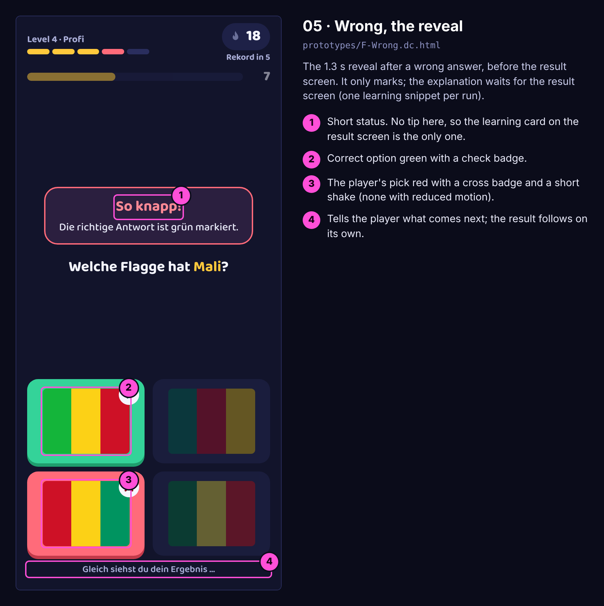

Clean: [screens/F-Wrong.png](screens/F-Wrong.png) · Prototype: [prototypes/F-Wrong.dc.html](prototypes/F-Wrong.dc.html)

The 1.3 s reveal after a wrong answer, before the result screen. It only marks; the explanation waits for the result screen.

1. Short status: "Leider falsch", or "Zeit abgelaufen" on a timeout.
2. Correct option green with a check badge.
3. The player's pick red with a cross badge and a short shake (none with reduced motion).
4. Tells the player what comes next; the result follows on its own.

## 06 · Game over, near miss

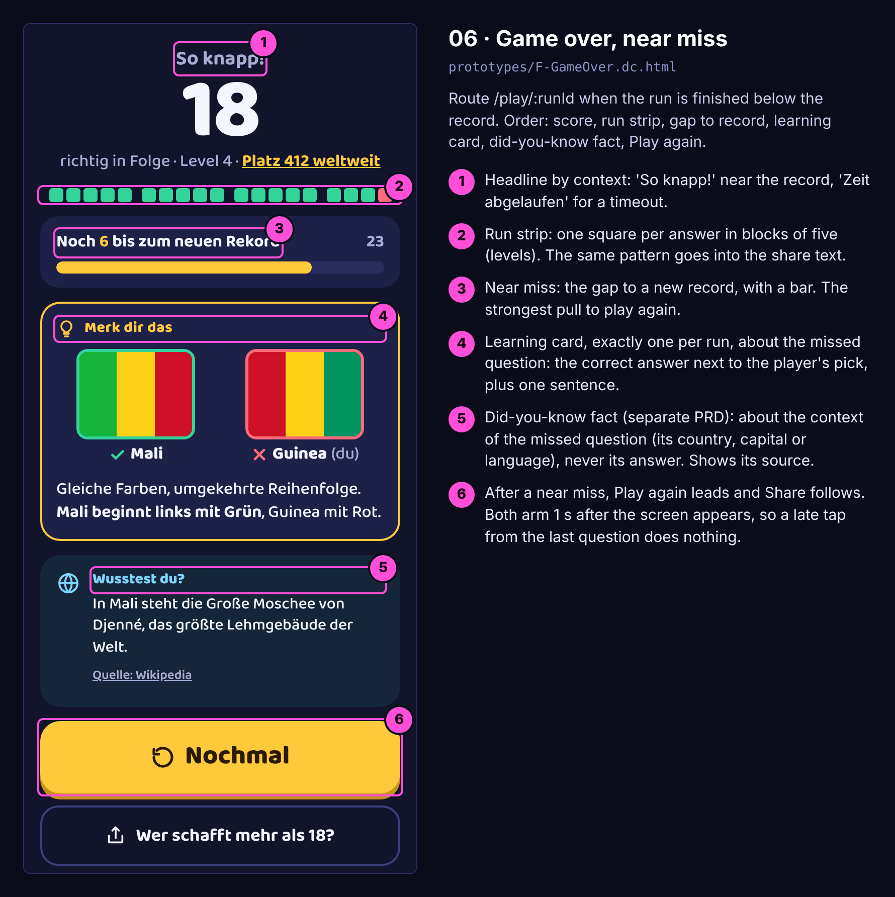

Clean: [screens/F-GameOver.png](screens/F-GameOver.png) · Prototype: [prototypes/F-GameOver.dc.html](prototypes/F-GameOver.dc.html)

Route /play/:runId when the run ended near the personal best. Order: head, score line, run strip, learning card, gap bar, then the sticky action bar.

1. The head follows the PRD's result table. "So knapp!" needs a gap of at most 3, or at most 15 % of the best. A far miss reads "Vorbei!" or "Zeit abgelaufen".
2. Run strip: one square per answer in blocks of five. The miss square carries a cross. The same pattern goes into the share text.
3. Gap bar: the questions to a new record. It shows only on a tie or a near miss.
4. Learning card, exactly one per run: the correct answer beside the pick, one template sentence and a fact row. The image shows a curated hook, which is out of scope.
5. The image shows a did-you-know card. It is absent until that PRD ships.
6. After a near miss, Play again leads and Share follows. Both are guarded for 1 s, so a late tap from the last question does nothing.

## 06b · Game over, text question

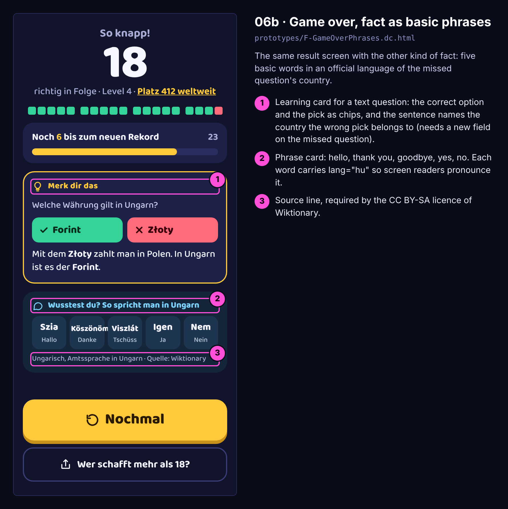

Clean: [screens/F-GameOverPhrases.png](screens/F-GameOverPhrases.png) · Prototype: [prototypes/F-GameOverPhrases.dc.html](prototypes/F-GameOverPhrases.dc.html)

The same result screen after a text question.

1. Learning card for a text question: the correct option and the pick as chips. When one pool country holds the pick, the sentence names it: "Polen – Währung: Złoty."
2. The image shows a phrase card from the did-you-know PRD. It is absent until that PRD ships.
3. The source line belongs to that card.

## 07 · Game over, new record

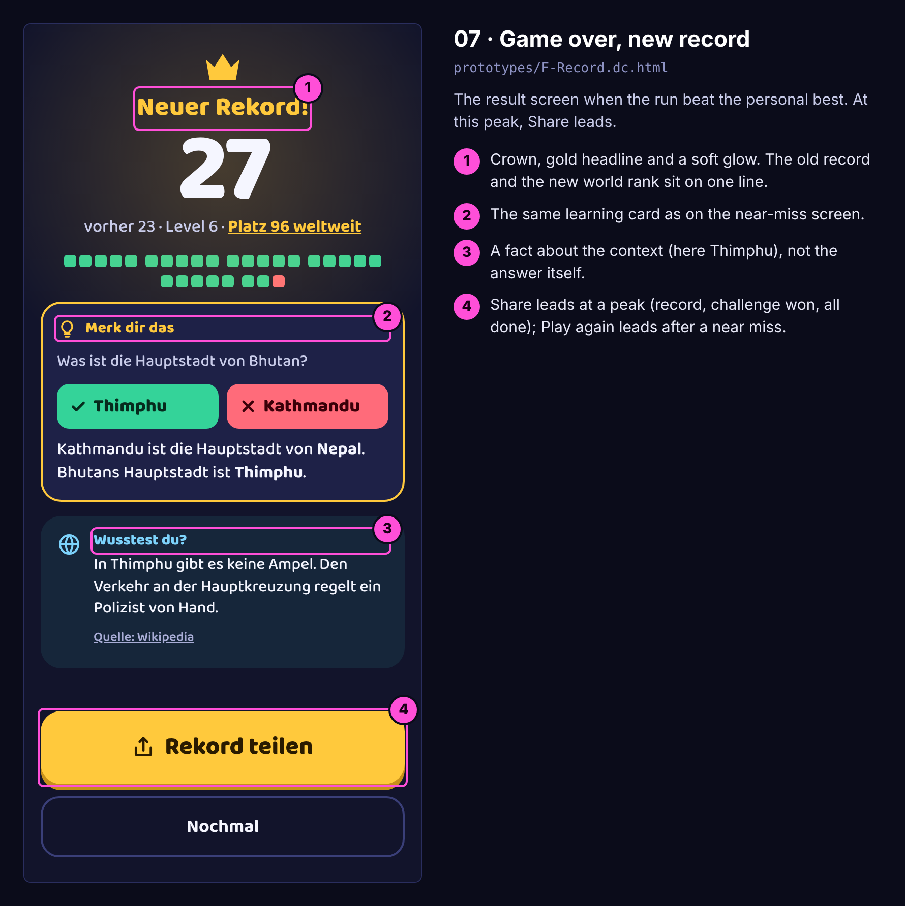

Clean: [screens/F-Record.png](screens/F-Record.png) · Prototype: [prototypes/F-Record.dc.html](prototypes/F-Record.dc.html)

The result screen when `best.isNew` holds. At this peak, Share leads.

1. Crown, gold headline and a soft glow. The line reads "vorher {old}" from `best.previous`. A creator run adds its world rank. A first run reads "Dein erster Rekord!" without "vorher".
2. The same learning card as on the near-miss screen.
3. The image shows a did-you-know card. It is absent until that PRD ships.
4. Share leads at a peak (first record, record, challenge won or tied, all done). Play again leads otherwise.

## 08 · Share sheet

Clean: [screens/F-Share.png](screens/F-Share.png) · Prototype: [prototypes/F-Share.dc.html](prototypes/F-Share.dc.html)

Opened from any share button. Shows what friends will receive, then hands off to the system share sheet or the clipboard.

1. Bottom sheet over the result: a native `<dialog>`. Close button 44 px; Escape closes; focus returns to the trigger.
2. Preview of the message: the static `og.png`, then the share text. The per-quiz image replaces it once its PRD ships.
3. Share text: score and level, the run strip as emoji, the challenge line and the link.
   🟩 per correct answer, 🟥 for a wrong miss, ⏱️ for a timeout; two blocks of five per line.
   A run of more than 10 answers shows "🟩 ×{k}", then the last two blocks. It spoils no question.
4. `navigator.share` where available (phones), else copy to the clipboard with a "Kopiert!" confirmation.

## 09 · Link preview image

Clean: [screens/F-LinkPreview.png](screens/F-LinkPreview.png) · Prototype: [prototypes/F-LinkPreview.dc.html](prototypes/F-LinkPreview.dc.html)

The Open Graph image for /q/<quizId>, specified in [prd-challenge-preview.md](../prds/prd-challenge-preview.md). Until it ships, every link shows the static `og.png`.

1. Creator name and score, the call to beat it. The name is escaped and cut at 20 characters (the name limit).
2. The rules in one line.
3. Score medallion; the flags are decoration and must not be flags of this quiz.

## 10 · Challenge link opened

Clean: [screens/F-Challenge.png](screens/F-Challenge.png) · Prototype: [prototypes/F-Challenge.dc.html](prototypes/F-Challenge.dc.html)

Route /q/:quizId once the creator run has ended. Target first, then the quiz leaderboard with an empty "Du" slot, then name and hold to accept.

1. Who challenges and with what score (challenge endpoint). With `creator.own`, the head reads "Dein Quiz" instead.
2. The concrete target: creator score + 1.
3. Empty slot in the quiz leaderboard: social proof plus a place to land.
4. HoldButton. A returning player sees `lastName` instead of the field, as on home.

## 11 · Challenger still playing

Clean: [screens/F-Waiting.png](screens/F-Waiting.png) · Prototype: [prototypes/F-Waiting.dc.html](prototypes/F-Waiting.dc.html)

Route /q/:quizId while the creator run is open (the server refuses runs then). Polls every 5 s as today.

1. Plain explanation instead of an error; the three dots pulse (static with reduced motion).
2. The name can be entered while waiting, so the start is instant.
3. `aria-disabled` until the creator run ends. Then it becomes the accept button, and a status says "Das Quiz ist jetzt offen."
4. A way out that keeps the visitor playing.

## 12 · Challenge won

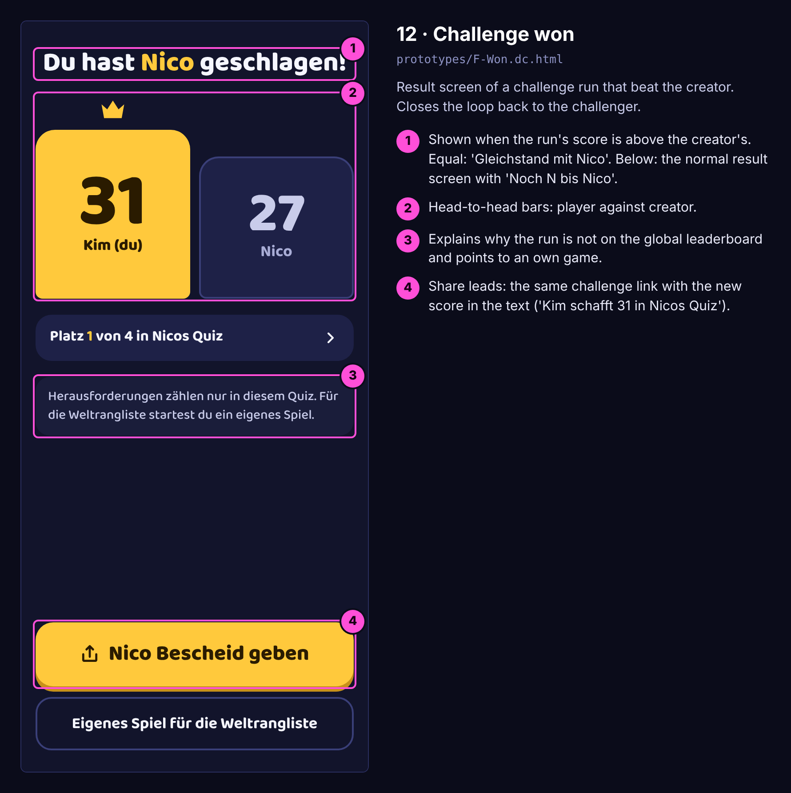

Clean: [screens/F-Won.png](screens/F-Won.png) · Prototype: [prototypes/F-Won.dc.html](prototypes/F-Won.dc.html)

Result screen of a challenge run that beat the creator. Closes the loop back to the challenger.

1. Shown when the score is above the creator's. Equal: "Gleichstand mit Nico". Below: "Noch N, um Nico zu schlagen". The PRD's result table sets each row's sections.
2. Head-to-head bars: player against creator. The run strip and the learning card follow; the image lacks both.
3. Explains why the run is not on the global leaderboard and points to an own game.
4. Share leads: the same challenge link with the new score in the text ("Ich habe 31 in Nicos Quiz geschafft").

A run on the player's own quiz (`creator.own`) skips this screen and uses the normal heads.

## 13 · Leaderboards

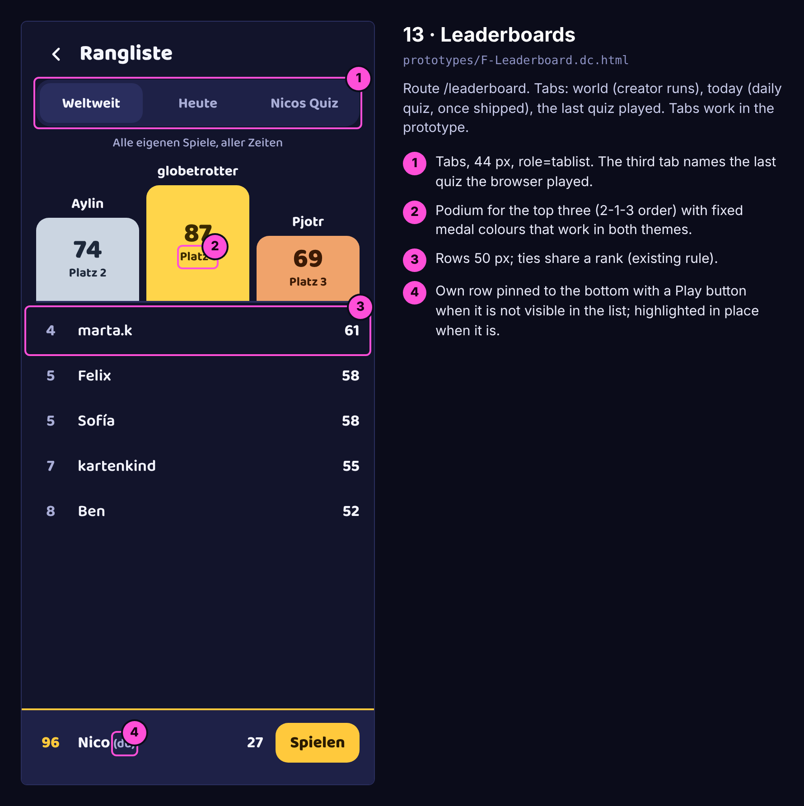

Clean: [screens/F-Leaderboard.png](screens/F-Leaderboard.png) · Prototype: [prototypes/F-Leaderboard.dc.html](prototypes/F-Leaderboard.dc.html)

Route /leaderboard. Tabs: world and "Letztes Quiz". The image's "Heute" tab is absent until the daily quiz ships.

1. Tabs, 44 px, `role=tablist`. "Letztes Quiz" shows the quiz of `lastQuizId` and is absent while it is null.
2. Podium for the top three (2-1-3 order) with fixed medal colours and inks.
3. Rows 50 px; one row per player, with their best run; ties share a rank.
4. The own row is highlighted in place inside the top 100. On the world tab, an own row outside it is pinned to the bottom from `/api/me` with a Play button.

## 14 · Reload mid-run

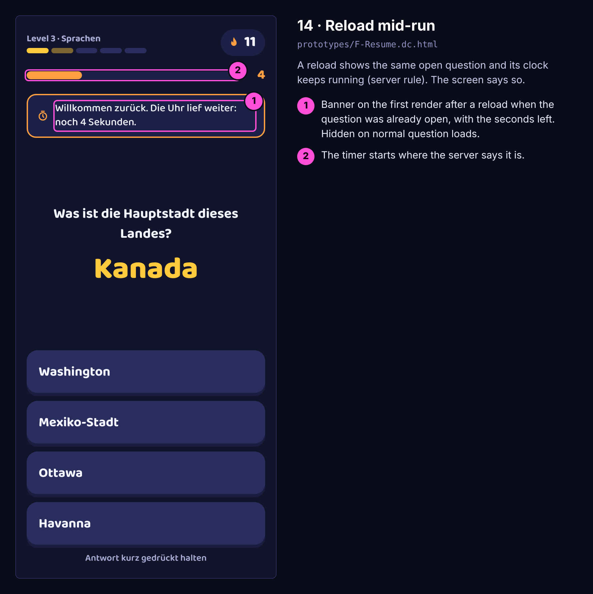

Clean: [screens/F-Resume.png](screens/F-Resume.png) · Prototype: [prototypes/F-Resume.dc.html](prototypes/F-Resume.dc.html)

A reload shows the same open question, and its clock keeps running (server rule). The screen says so.

1. Banner when the first data fetched after mount has `deadline − serverNow < limitMs`, with the seconds left. Hidden on normal question loads.
2. The timer starts where the server says it is. An expired open question loads as the timeout result instead.

## 15 · Connection lost while answering

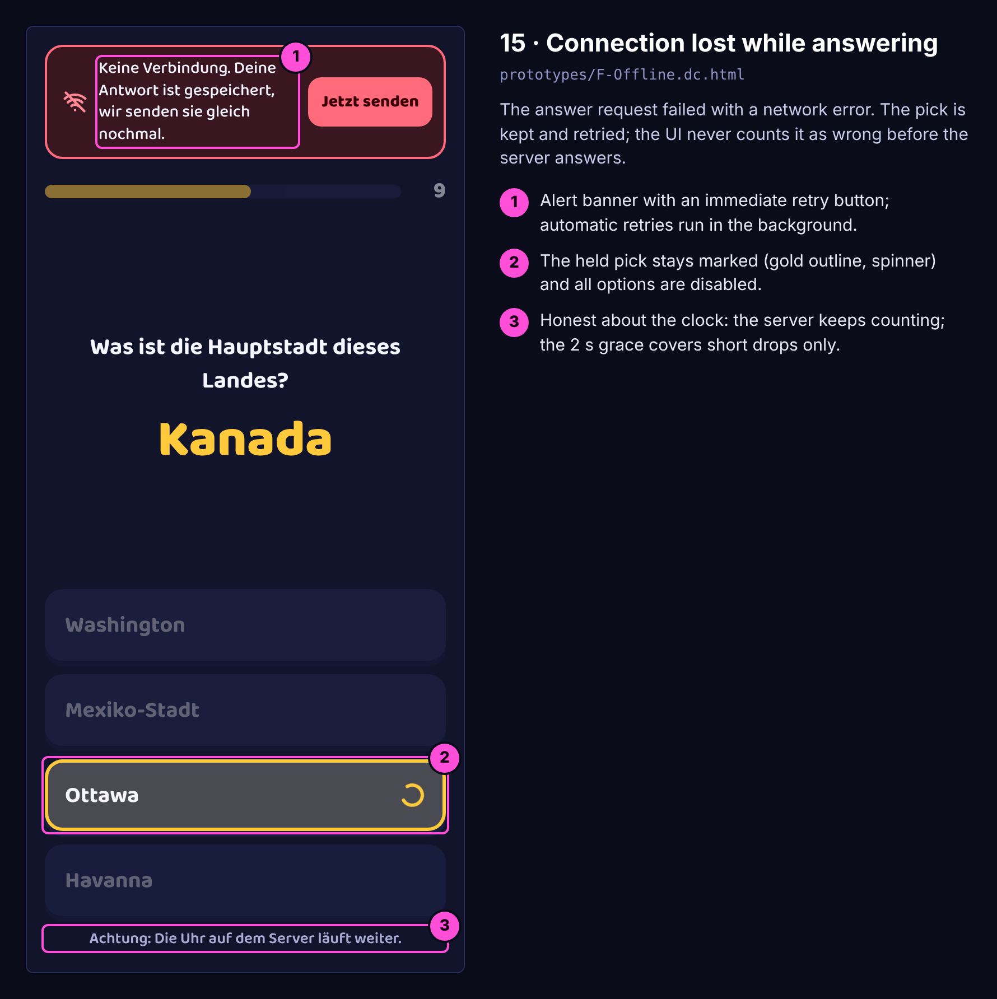

Clean: [screens/F-Offline.png](screens/F-Offline.png) · Prototype: [prototypes/F-Offline.dc.html](prototypes/F-Offline.dc.html)

The answer request failed with a network error. The pick is kept and retried; the UI never counts it as wrong before the server answers.

1. Alert banner with an immediate retry button; automatic retries run until the deadline plus the 2 s grace.
2. The held pick stays marked (gold outline, spinner) and all options are `aria-disabled`.
3. Honest about the clock: the server keeps counting; the 2 s grace covers short drops only.

## 16 · All 197 countries done

Clean: [screens/F-Completed.png](screens/F-Completed.png) · Prototype: [prototypes/F-Completed.dc.html](prototypes/F-Completed.dc.html)

End reason `completed`: every country of the quiz pool was a target. Rare, so it gets the biggest celebration.

1. Headline and 197 in gold.
2. 197 gold squares, one per country.
3. Share leads.

## Explorations

The three variants that led to A+ (see [analysis.md](analysis.md#3-variants-explored)). Prototypes in `prototypes/explorations/`.

| A · Arcade | B · Atlas | C · Thumb |
| --- | --- | --- |
|  | 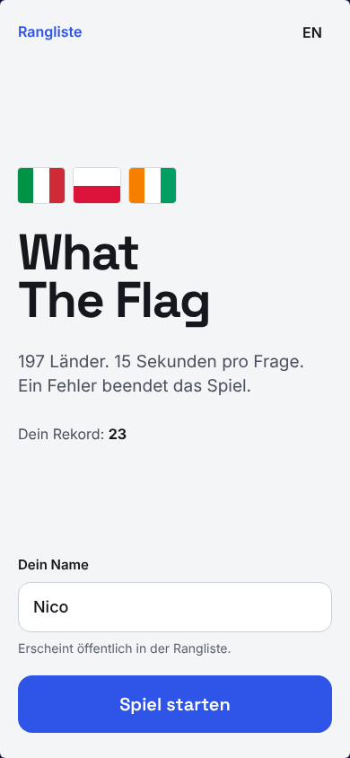 | 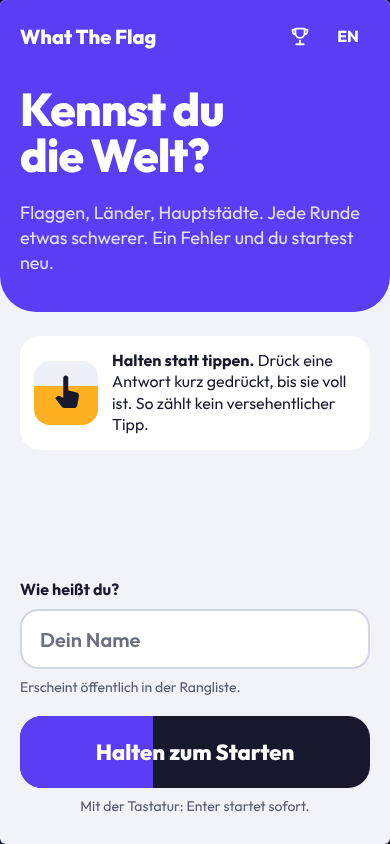 |
| 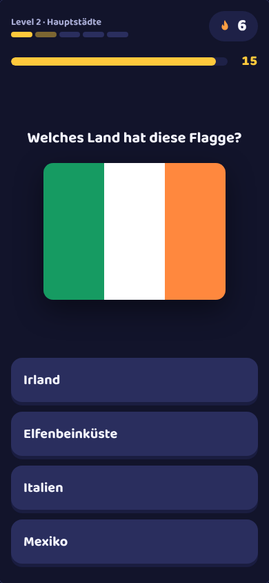 | 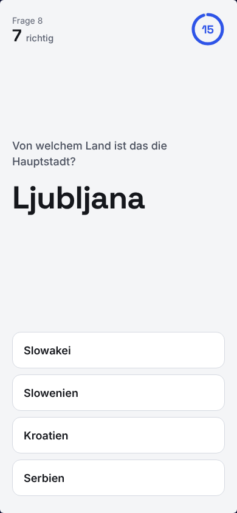 | 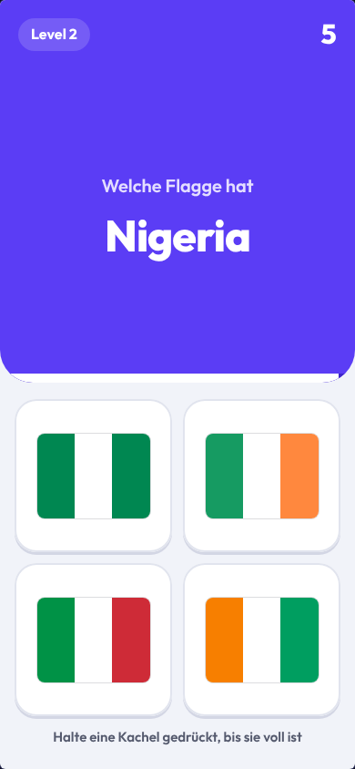 |
| 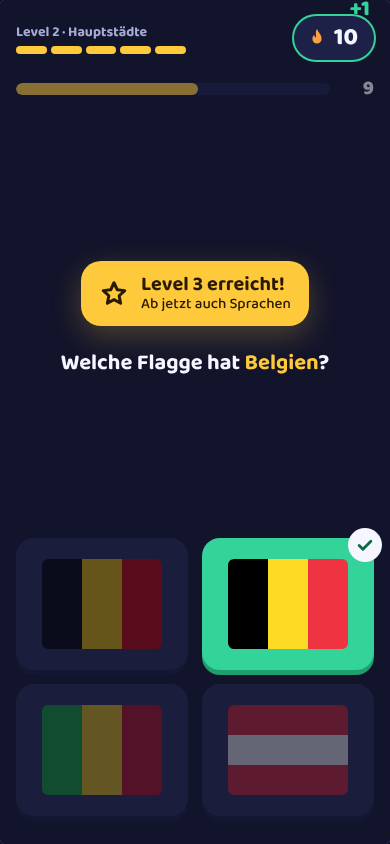 |  |  |
| 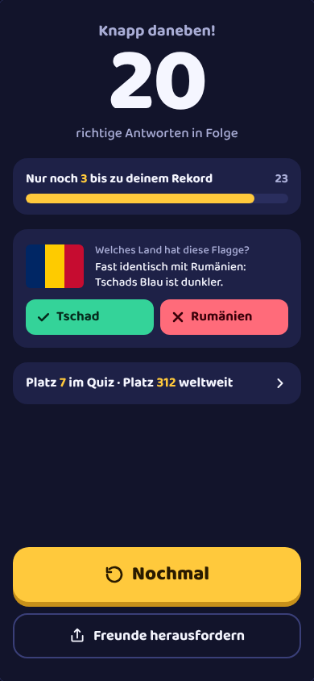 |  |  |
|  |  |  |
|  |  |  |
