# Screens

Every screen of the final design (A+). Each entry links the annotated screenshot (numbered callouts), the clean screenshot and the prototype source.
The numbered notes are the same as in the annotated images; `tools/annotations.json` is their source.

Flows:

- **First run:** 01 → 03 → 04/05 → 06 or 07 → 08
- **Returning player:** 02 → 03 → … ; or 02 → overtaken card → 10
- **Challenged visitor:** 09 (in the chat) → 11 while the challenger plays → 10 → 03 → 12 → 08
- **Edge cases:** 14 (reload), 15 (connection lost), 16 (every country done)

## 01 · Home, first visit

Clean: [screens/F-HomeFirst.png](screens/F-HomeFirst.png) · Prototype: [prototypes/F-HomeFirst.dc.html](prototypes/F-HomeFirst.dc.html)

Route /. Shown when the browser has no stored name. The only job: get a name and start. The start button teaches the hold mechanic before the first question.

1. One headline, no navbar items besides the language switch. The flag collage is decoration (aria-hidden).
2. Three numbered rules replace the old chips: time limit, a level every 5 questions, one miss ends the run.
3. Name field: label above, 56 px tall, maxlength 20, autocomplete nickname. The hint says the name is public (PRD requirement).
4. HoldButton: press and hold 400 ms, the darker fill runs left to right; release early cancels. Enter or Space starts at once. Teaches the answer mechanic.
5. One line connects the start hold to answering.

## 02 · Home, returning player

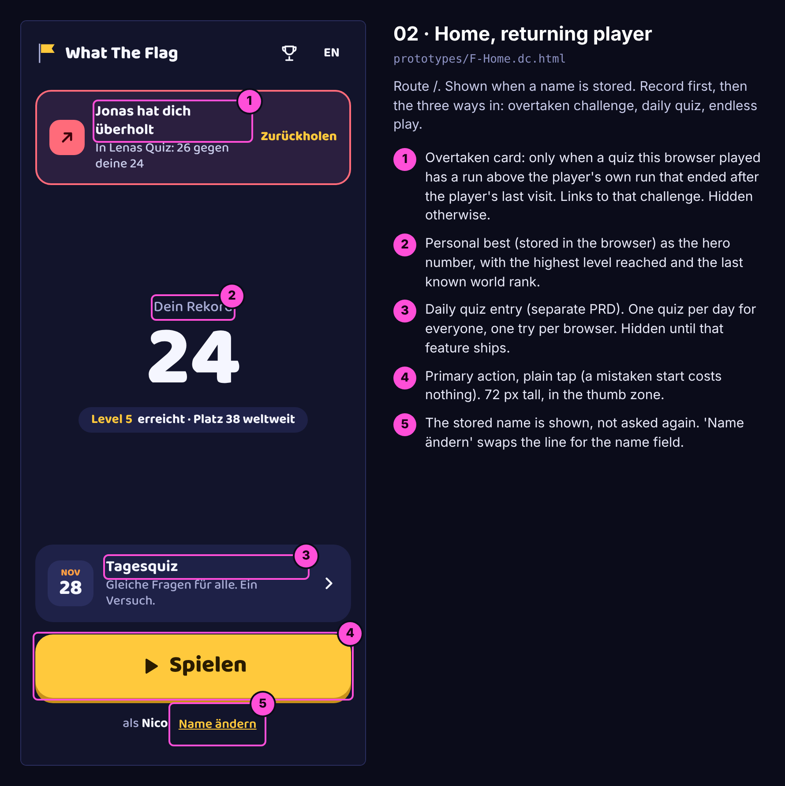

Clean: [screens/F-Home.png](screens/F-Home.png) · Prototype: [prototypes/F-Home.dc.html](prototypes/F-Home.dc.html)

Route /. Shown when a name is stored. Record first, then the three ways in: overtaken challenge, daily quiz, endless play.

1. Overtaken card: only when a quiz this browser played has a run above the player's own run that ended after the player's last visit. Links to that challenge. Hidden otherwise.
2. Personal best (stored in the browser) as the hero number, with the highest level reached and the last known world rank.
3. Daily quiz entry (separate PRD). One quiz per day for everyone, one try per browser. Hidden until that feature ships.
4. Primary action, plain tap (a mistaken start costs nothing). 72 px tall, in the thumb zone.
5. The stored name is shown, not asked again. 'Name ändern' swaps the line for the name field.

## 03 · Question (playable)

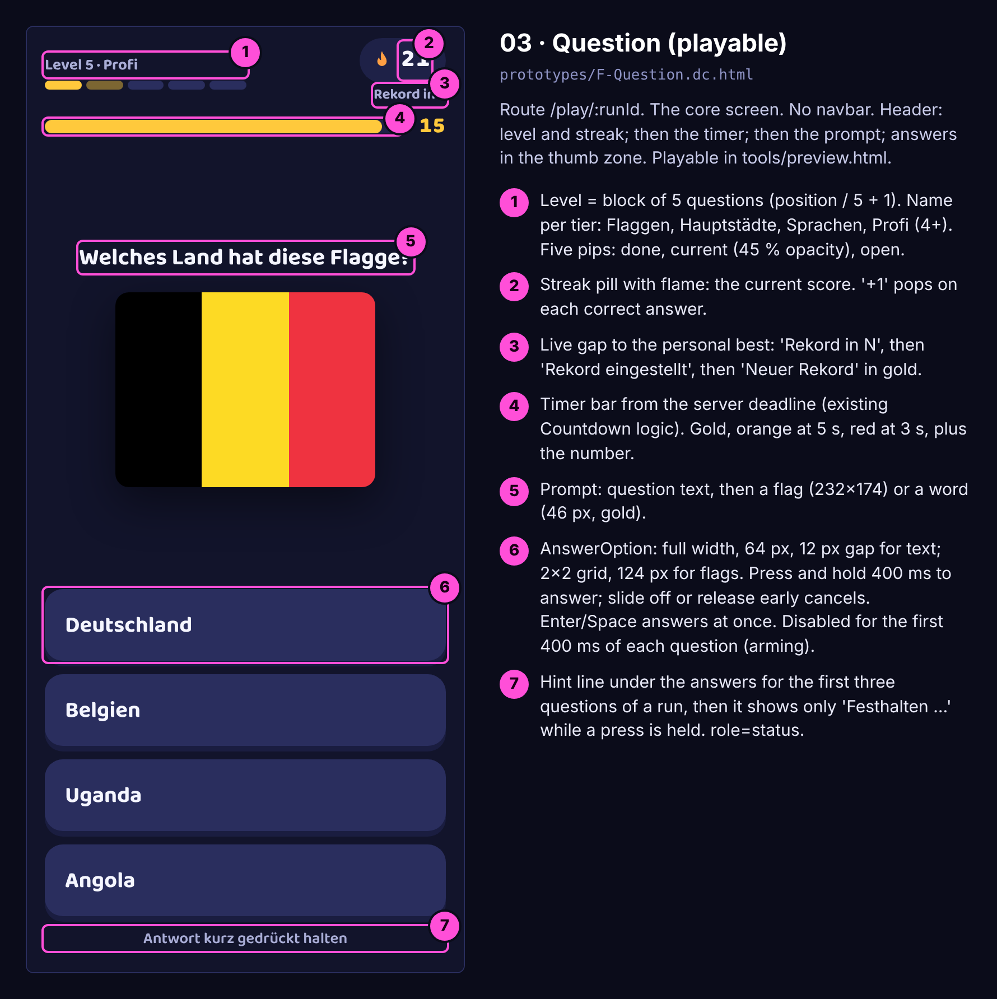

Clean: [screens/F-Question.png](screens/F-Question.png) · Prototype: [prototypes/F-Question.dc.html](prototypes/F-Question.dc.html)

Route /play/:runId. The core screen. No navbar. Header: level and streak; then the timer; then the prompt; answers in the thumb zone. Playable in tools/preview.html.

1. Level = block of 5 questions (position / 5 + 1). Name per tier: Flaggen, Hauptstädte, Sprachen, Profi (4+). Five pips: done, current (45 % opacity), open.
2. Streak pill with flame: the current score. '+1' pops on each correct answer.
3. Live gap to the personal best: 'Rekord in N', then 'Rekord eingestellt', then 'Neuer Rekord' in gold.
4. Timer bar from the server deadline (existing Countdown logic). Gold, orange at 5 s, red at 3 s, plus the number.
5. Prompt: question text, then a flag (232×174) or a word (46 px, gold).
6. AnswerOption: full width, 64 px, 12 px gap for text; 2×2 grid, 124 px for flags. Press and hold 400 ms to answer; slide off or release early cancels. Enter/Space answers at once. Disabled for the first 400 ms of each question (arming).
7. Hint line under the answers for the first three questions of a run, then it shows only 'Festhalten …' while a press is held. role=status.

## 04 · Correct, record passed live

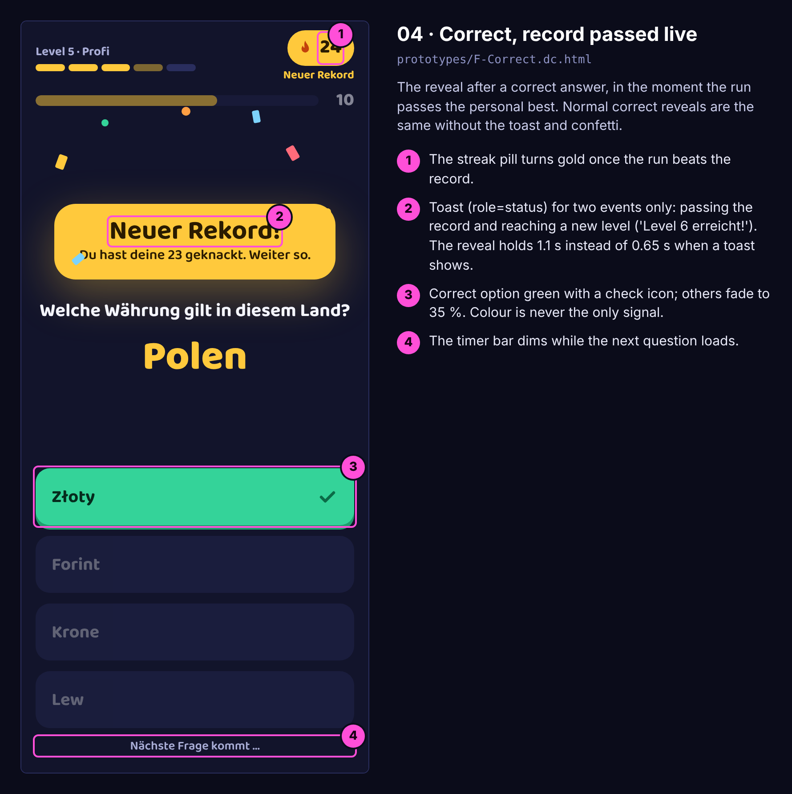

Clean: [screens/F-Correct.png](screens/F-Correct.png) · Prototype: [prototypes/F-Correct.dc.html](prototypes/F-Correct.dc.html)

The reveal after a correct answer, in the moment the run passes the personal best. Normal correct reveals are the same without the toast and confetti.

1. The streak pill turns gold once the run beats the record.
2. Toast (role=status) for two events only: passing the record and reaching a new level ('Level 6 erreicht!'). The reveal holds 1.1 s instead of 0.65 s when a toast shows.
3. Correct option green with a check icon; others fade to 35 %. Colour is never the only signal.
4. The timer bar dims while the next question loads.

## 05 · Wrong, the reveal

Clean: [screens/F-Wrong.png](screens/F-Wrong.png) · Prototype: [prototypes/F-Wrong.dc.html](prototypes/F-Wrong.dc.html)

The 1.3 s reveal after a wrong answer, before the result screen. It only marks; the explanation waits for the result screen (one learning snippet per run).

1. Short status. No tip here, so the learning card on the result screen is the only one.
2. Correct option green with a check badge.
3. The player's pick red with a cross badge and a short shake (none with reduced motion).
4. Tells the player what comes next; the result follows on its own.

## 06 · Game over, near miss

Clean: [screens/F-GameOver.png](screens/F-GameOver.png) · Prototype: [prototypes/F-GameOver.dc.html](prototypes/F-GameOver.dc.html)

Route /play/:runId when the run is finished below the record. Order: score, run strip, gap to record, learning card, did-you-know fact, Play again.

1. Headline by context: 'So knapp!' near the record, 'Zeit abgelaufen' for a timeout.
2. Run strip: one square per answer in blocks of five (levels). The same pattern goes into the share text.
3. Near miss: the gap to a new record, with a bar. The strongest pull to play again.
4. Learning card, exactly one per run, about the missed question: the correct answer next to the player's pick, plus one sentence.
5. Did-you-know fact (separate PRD): about the context of the missed question (its country, capital or language), never its answer. Shows its source.
6. After a near miss, Play again leads and Share follows. Both arm 1 s after the screen appears, so a late tap from the last question does nothing.

## 06b · Game over, fact as basic phrases

Clean: [screens/F-GameOverPhrases.png](screens/F-GameOverPhrases.png) · Prototype: [prototypes/F-GameOverPhrases.dc.html](prototypes/F-GameOverPhrases.dc.html)

The same result screen with the other kind of fact: five basic words in an official language of the missed question's country.

1. Learning card for a text question: the correct option and the pick as chips, and the sentence names the country the wrong pick belongs to (needs a new field on the missed question).
2. Phrase card: hello, thank you, goodbye, yes, no. Each word carries lang="hu" so screen readers pronounce it.
3. Source line, required by the CC BY-SA licence of Wiktionary.

## 07 · Game over, new record

Clean: [screens/F-Record.png](screens/F-Record.png) · Prototype: [prototypes/F-Record.dc.html](prototypes/F-Record.dc.html)

The result screen when the run beat the personal best. At this peak, Share leads.

1. Crown, gold headline and a soft glow. The old record and the new world rank sit on one line.
2. The same learning card as on the near-miss screen.
3. A fact about the context (here Thimphu), not the answer itself.
4. Share leads at a peak (record, challenge won, all done); Play again leads after a near miss.

## 08 · Share sheet

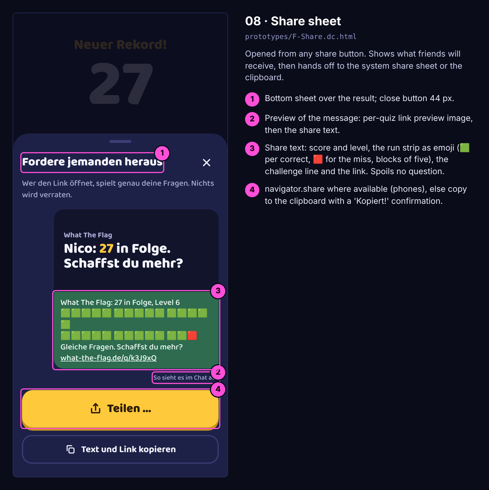

Clean: [screens/F-Share.png](screens/F-Share.png) · Prototype: [prototypes/F-Share.dc.html](prototypes/F-Share.dc.html)

Opened from any share button. Shows what friends will receive, then hands off to the system share sheet or the clipboard.

1. Bottom sheet over the result; close button 44 px.
2. Preview of the message: per-quiz link preview image, then the share text.
3. Share text: score and level, the run strip as emoji (🟩 per correct, 🟥 for the miss, blocks of five), the challenge line and the link. Spoils no question.
4. navigator.share where available (phones), else copy to the clipboard with a 'Kopiert!' confirmation.

## 09 · Link preview image

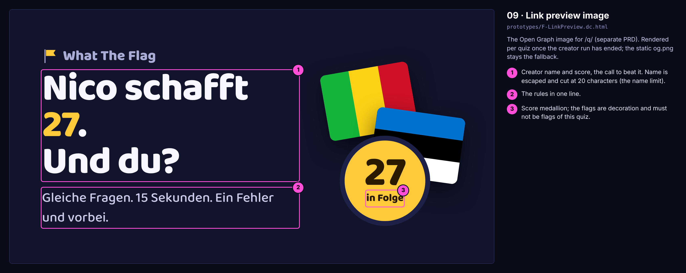

Clean: [screens/F-LinkPreview.png](screens/F-LinkPreview.png) · Prototype: [prototypes/F-LinkPreview.dc.html](prototypes/F-LinkPreview.dc.html)

The Open Graph image for /q/<quizId> (separate PRD). Rendered per quiz once the creator run has ended; the static og.png stays the fallback.

1. Creator name and score, the call to beat it. Name is escaped and cut at 20 characters (the name limit).
2. The rules in one line.
3. Score medallion; the flags are decoration and must not be flags of this quiz.

## 10 · Challenge link opened

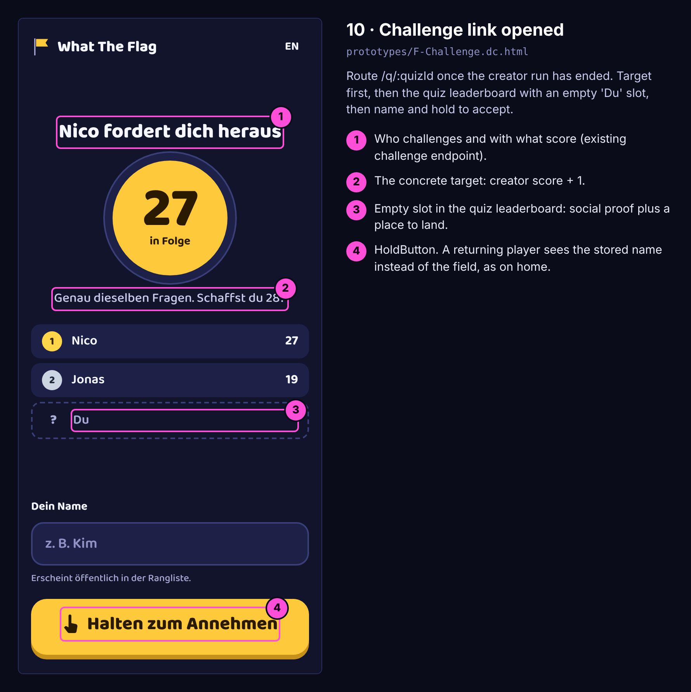

Clean: [screens/F-Challenge.png](screens/F-Challenge.png) · Prototype: [prototypes/F-Challenge.dc.html](prototypes/F-Challenge.dc.html)

Route /q/:quizId once the creator run has ended. Target first, then the quiz leaderboard with an empty 'Du' slot, then name and hold to accept.

1. Who challenges and with what score (existing challenge endpoint).
2. The concrete target: creator score + 1.
3. Empty slot in the quiz leaderboard: social proof plus a place to land.
4. HoldButton. A returning player sees the stored name instead of the field, as on home.

## 11 · Challenger still playing

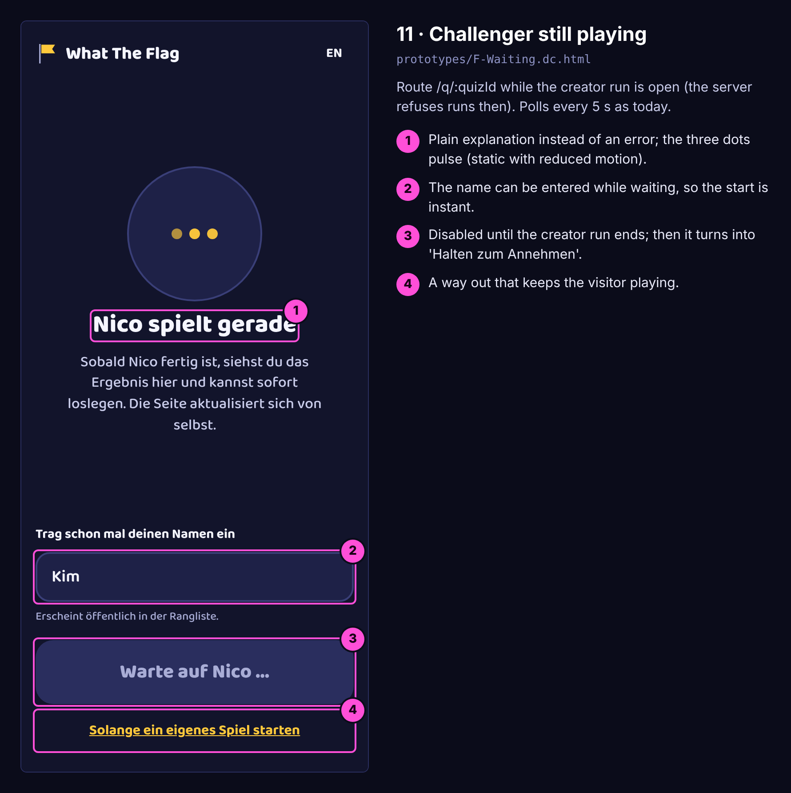

Clean: [screens/F-Waiting.png](screens/F-Waiting.png) · Prototype: [prototypes/F-Waiting.dc.html](prototypes/F-Waiting.dc.html)

Route /q/:quizId while the creator run is open (the server refuses runs then). Polls every 5 s as today.

1. Plain explanation instead of an error; the three dots pulse (static with reduced motion).
2. The name can be entered while waiting, so the start is instant.
3. Disabled until the creator run ends; then it turns into 'Halten zum Annehmen'.
4. A way out that keeps the visitor playing.

## 12 · Challenge won

Clean: [screens/F-Won.png](screens/F-Won.png) · Prototype: [prototypes/F-Won.dc.html](prototypes/F-Won.dc.html)

Result screen of a challenge run that beat the creator. Closes the loop back to the challenger.

1. Shown when the run's score is above the creator's. Equal: 'Gleichstand mit Nico'. Below: the normal result screen with 'Noch N bis Nico'.
2. Head-to-head bars: player against creator.
3. Explains why the run is not on the global leaderboard and points to an own game.
4. Share leads: the same challenge link with the new score in the text ('Kim schafft 31 in Nicos Quiz').

## 13 · Leaderboards

Clean: [screens/F-Leaderboard.png](screens/F-Leaderboard.png) · Prototype: [prototypes/F-Leaderboard.dc.html](prototypes/F-Leaderboard.dc.html)

Route /leaderboard. Tabs: world (creator runs), today (daily quiz, once shipped), the last quiz played. Tabs work in the prototype.

1. Tabs, 44 px, role=tablist. The third tab names the last quiz the browser played.
2. Podium for the top three (2-1-3 order) with fixed medal colours that work in both themes.
3. Rows 50 px; ties share a rank (existing rule).
4. Own row pinned to the bottom with a Play button when it is not visible in the list; highlighted in place when it is.

## 14 · Reload mid-run

Clean: [screens/F-Resume.png](screens/F-Resume.png) · Prototype: [prototypes/F-Resume.dc.html](prototypes/F-Resume.dc.html)

A reload shows the same open question and its clock keeps running (server rule). The screen says so.

1. Banner on the first render after a reload when the question was already open, with the seconds left. Hidden on normal question loads.
2. The timer starts where the server says it is.

## 15 · Connection lost while answering

Clean: [screens/F-Offline.png](screens/F-Offline.png) · Prototype: [prototypes/F-Offline.dc.html](prototypes/F-Offline.dc.html)

The answer request failed with a network error. The pick is kept and retried; the UI never counts it as wrong before the server answers.

1. Alert banner with an immediate retry button; automatic retries run in the background.
2. The held pick stays marked (gold outline, spinner) and all options are disabled.
3. Honest about the clock: the server keeps counting; the 2 s grace covers short drops only.

## 16 · All 197 countries done

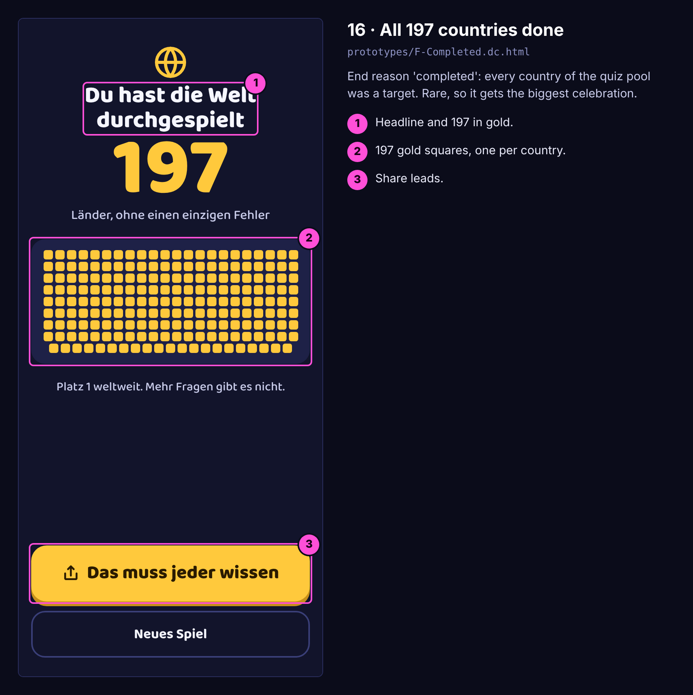

Clean: [screens/F-Completed.png](screens/F-Completed.png) · Prototype: [prototypes/F-Completed.dc.html](prototypes/F-Completed.dc.html)

End reason 'completed': every country of the quiz pool was a target. Rare, so it gets the biggest celebration.

1. Headline and 197 in gold.
2. 197 gold squares, one per country.
3. Share leads.

## Explorations

The three variants that led to A+ (see [analysis.md](analysis.md#3-variants-explored)). Prototypes in `prototypes/explorations/`.

| A · Arcade | B · Atlas | C · Thumb |
| --- | --- | --- |
| 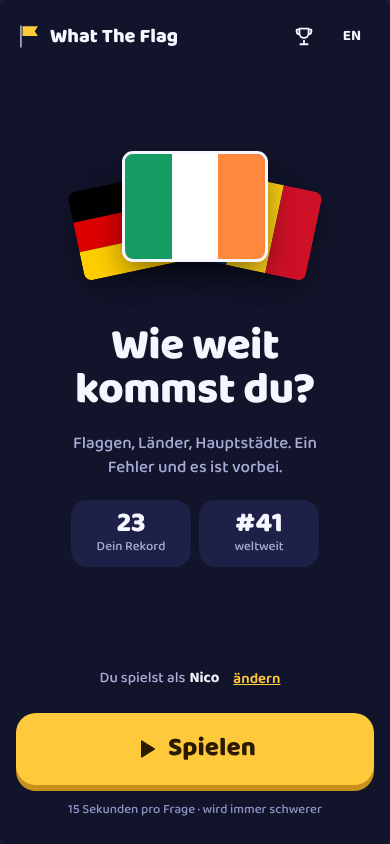 |  |  |
|  |  |  |
|  | 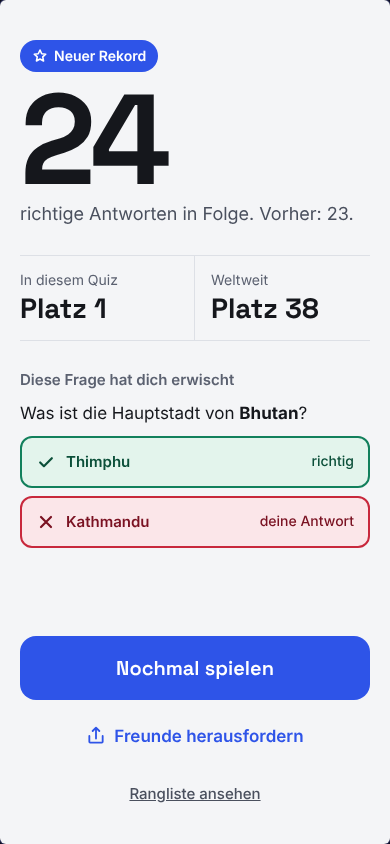 | 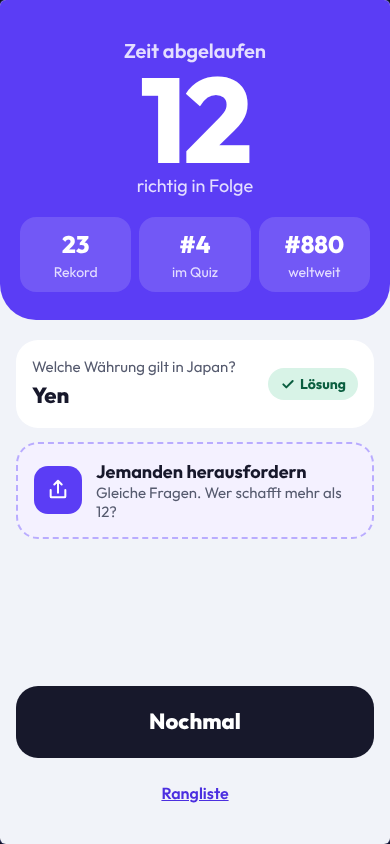 |
|  | 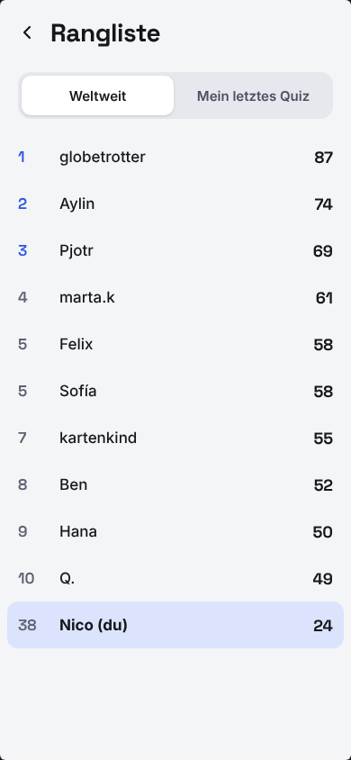 | 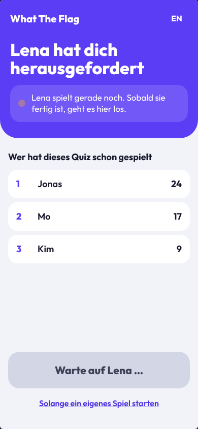 |
| 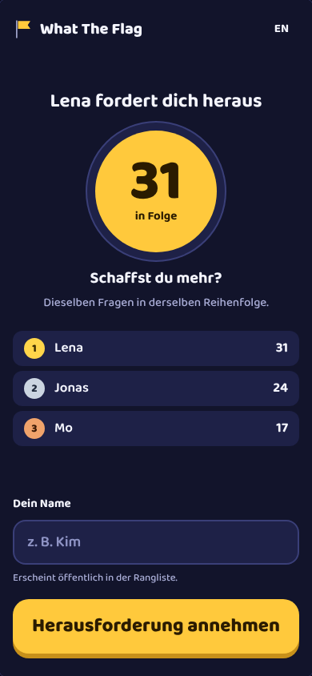 |  |  |
| 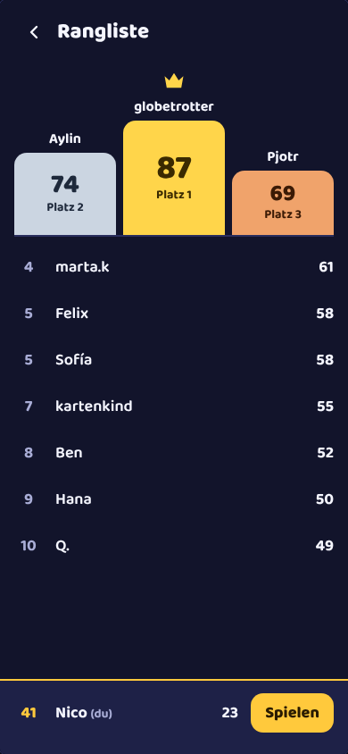 |  |  |
